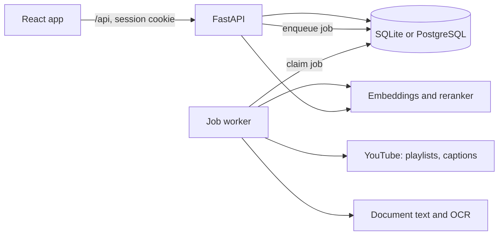

# Architecture

Back to [[Project Map]].

## Components

- **API** (`backend/app/main.py`, `routers/`): stateless. Serves the built frontend
  from `frontend/dist` as well, so one process is a complete deployment.
- **Job queue** (`services/jobs.py`): rows in the `jobs` table. A worker claims a
  job with a guarded UPDATE (`FOR UPDATE SKIP LOCKED` on PostgreSQL), heartbeats,
  and is retried if it dies. Runs inside the API process by default
  (`RUN_WORKER=true`) or as separate processes (`python -m app.worker`).
- **Pipeline** (`services/pipeline.py`): playlists, transcripts, documents, topics,
  embeddings, recommendations, questions. Every stage is incremental.
- **Matching** (`services/recommend.py` and friends): see [[Matching Pipeline]].
  Fast enough to re-run inline after every feedback click.

## Data model (`backend/app/models.py`)

| Table | Holds |
|---|---|
| `users` | Accounts |
| `projects` | One course; owns everything below; `relevance_threshold` learned from feedback |
| `playlists` | Playlist links, in the student's priority order |
| `videos` | One per video per project; metadata, transcript status and language, watched flag |
| `video_chunks` | Text windows of about 75 s with embeddings; chunk 0 is title and description |
| `documents` | Uploaded or pasted syllabus, exam, notes; extracted text |
| `topics` | Ordered syllabus topics; exam hits, in-notes flag, covered flag, embedding |
| `recommendations` | Topic to video links; rank 0 is the pick in the path |
| `questions` | Past exam questions with their topic and answering video moment |
| `feedback` | The student's judgement of a topic and video pair |
| `rerank_scores` | Cached raw cross-encoder scores |
| `jobs` | Queue, progress, warnings, scheduled retries |

## Flow of one analysis

1. Student adds sources and presses Build. `POST /api/projects/{id}/process` creates
   a `queued` job.
2. The worker runs the pipeline and writes progress to the job row. The browser
   polls `GET /api/projects/{id}` every 1.5 s while the job is active.
3. When it ends, the browser reloads the path and questions.
4. Feedback, topic edits and reordering call the API, which re-plans the path
   inline and returns it.

## Scaling notes

- API instances are stateless; add more behind a load balancer.
- Workers scale independently; the queue gives each job to one worker.
- Vectors are stored as blobs and searched exactly in memory per project. That is
  right up to tens of thousands of chunks per project. Beyond that, move to
  pgvector; `ProjectIndex` in `services/matching.py` is the only place to change.
- The auth rate limiter is per process. Put a shared limiter in front for strict
  limits across instances.

## Related

[[Backend]], [[Frontend]], [[Decisions]]
