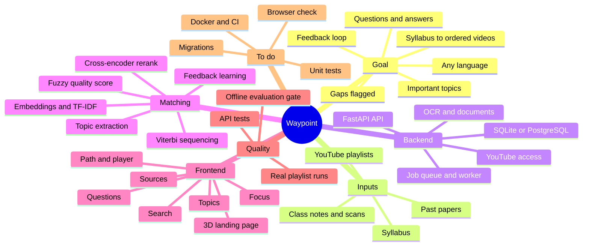

# Project Map

Start here. This folder is an Obsidian vault: open `docs/` with "Open folder as
vault" and use the graph view to see the project as a map. Every note is plain
Markdown, so it reads the same without Obsidian.

**If you are an AI or a person picking this work up, read in this order:**

1. [[Goal and Requirements]]: what is being built and what the owner asked for.
2. [[Progress]]: what is done, what is in progress, the exact next step.
3. [[Architecture]]: how the pieces fit.
4. The note for the part you are about to touch.

## Mind map

## Notes

| Note | What it covers |
|---|---|
| [[Goal and Requirements]] | The idea, every requirement the owner added, what "done" means |
| [[Requirements Checklist]] | Every requirement in the idea document with its status and evidence |
| [[Progress]] | Checkpoint log, current state, next steps in order |
| [[Architecture]] | Components, data model, request and job flow |
| [[Matching Pipeline]] | How a topic becomes a video recommendation, with measured numbers |
| [[Backend]] | Files, endpoints, configuration, how to run |
| [[Frontend]] | Design decisions, screens, files |
| [[Evaluation and Testing]] | Tests, the quality gate, real-playlist tools |
| [[Decisions]] | Choices already made and why, so they are not re-argued |

## Where things are

- Code: `backend/` (Python) and `frontend/` (React).
- Repository: `github.com/R-PAl-AIhub/Ai-powered-video-recommendation-system-for-students`, branch `main`.
- Not in git, on the owner's machine only: `idea.docx`, four `AI Agent Skills*.docx`
  link lists, `backend/.venv/`, `backend/data/` (model files and cached databases),
  `frontend/node_modules/`.
